<p align="center">
  <a href="https://decoyindia.github.io/candy-drop/arcade.html">
    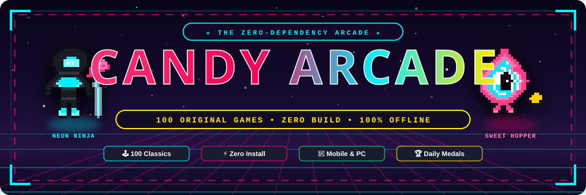
  </a>
</p>

<p align="center">
  <b>100 ORIGINAL BROWSER GAMES &nbsp;•&nbsp; ZERO INSTALL &nbsp;•&nbsp; ZERO DEPENDENCIES &nbsp;•&nbsp; 60 FPS PURE CANVAS</b>
</p>

<p align="center">
  <a href="https://github.com/decoyindia/candy-drop"></a>
  <a href="https://decoyindia.github.io/candy-drop/arcade.html"></a>
  <a href="https://decoyindia.github.io/candy-drop/arcade.html"></a>
  <a href="https://decoyindia.github.io/candy-drop/arcade.html"></a>
  <a href="https://decoyindia.github.io/candy-drop/arcade.html"></a>
</p>

<p align="center">
  <a href="https://decoyindia.github.io/candy-drop/arcade.html">
    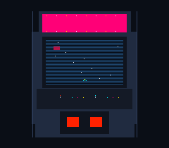
  </a>
  <br>
  <a href="https://decoyindia.github.io/candy-drop/arcade.html">
    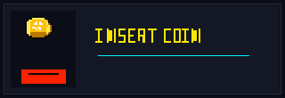
  </a>
</p>

<p align="center">
  <a href="https://decoyindia.github.io/candy-drop/arcade.html"><b>🕹️ ENTER CANDY ARCADE HUB (100 GAMES) →</b></a>
  &nbsp;&nbsp;•&nbsp;&nbsp;
  <a href="https://decoyindia.github.io/candy-drop/index.html"><b>🍬 PLAY ORIGINAL CANDY DROP →</b></a>
  &nbsp;&nbsp;•&nbsp;&nbsp;
  <a href="portal.html"><b>✨ ARCADE LAB & SOUNDBOARD PORTAL →</b></a>
</p>

---

## 🎟️ The Arcade Passport: Admit One

<p align="center">
  <a href="https://decoyindia.github.io/candy-drop/arcade.html">
    
  </a>
</p>

Welcome to **Candy Arcade**—an extraordinary universe of **100 handcrafted, zero-dependency browser games** built entirely on the native web platform. 

In an era where loading a casual web page often demands forty megabytes of bloated JavaScript bundles, intrusive tracking telemetry, and mandatory account paywalls, Candy Arcade stands as a radical design manifesto: **pure, instant, unadulterated gameplay that boots in milliseconds, runs offline, and will still play flawlessly thirty years from today.**

Every single game in this collection is an autonomous micro-world featuring:
* 🚀 **Zero Downloads & Zero Install:** Run directly from GitHub Pages or locally via `file://` protocol.
* 📦 **Zero External Dependencies:** No React, no Vue, no Webpack, no Vite, no Phaser. Pure HTML5 Canvas, Web Audio, and Vanilla JavaScript.
* 🖥️ **Unified 960 × 600 Virtual Canvas:** Responsive 16:10 aspect ratio with integer DPR scaling and dedicated board focus crops.
* 🎮 **Universal Input Duality:** Responsive multi-touch on-screen d-pads and comprehensive desktop keyboard bindings on every title.
* 📅 **Daily Seeded Global Challenges:** Synchronized UTC midnight PRNG seeds for daily competition on an even playing field.
* 🏆 **Trophy & Medal Progression:** Bronze, Silver, and Gold mastery thresholds backed by resilient, isolated local storage.

---

## ⚡ Why This Arcade Is Built Different

| Architectural Pillar | How Typical Web Games Work | How Candy Arcade Operates |
| :--- | :--- | :--- |
| **Dependency Footprint** | Heavy 15–50 MB node_modules, bundlers, and third-party engines. | **0 KB dependencies.** 100% written in standard, evergreen browser APIs. |
| **Startup Latency** | Lengthy loading screens, asset fetching, and splash ads. | **Instantaneous.** 0ms bundle parse; renders first interactive frame immediately. |
| **Audio Engine** | Hundreds of megabytes of MP3/WAV files causing buffering lag. | **Zero-byte Web Audio synthesizer chip.** Procedural sine, triangle, square, saw & noise waveforms. |
| **Persistence & Privacy** | Remote telemetry, analytics trackers, cloud authentication logins. | **100% private & offline.** High scores remain strictly in your browser's `localStorage`. |
| **Deterministic PRNG** | Non-repeatable `Math.random()` making fair competition impossible. | **Seeded Mulberry32 PRNG.** Daily challenges reset at 00:00 UTC with identical procedural layouts. |
| **Platform Portability** | Fragmented touch support; breaks on mobile without native apps. | **Native input duality.** Automatic viewport scaling from 390px phones to 4K desktop screens. |

---

## 🏛️ The Arcade Floor: Eight Curated Wings

The 100 cabinets of Candy Arcade are systematically organized into eight specialized architectural wings, each presided over by a legendary genre champion mascot:

<p align="center">
  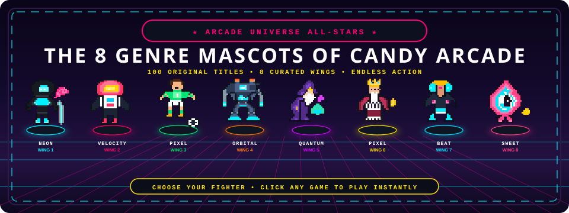
</p>

| Wing & Sector | Mascot Champion | Cabinets | Signature Mechanical Essence |
| :--- | :--- | :---: | :--- |
| **[Wing 1: Action](#wing-1-action-sector-)** | **Neon Ninja** (*Cyber Shinobi*) | 19 | Kinetic agility, parry frames, bullet-hell evasion, and dungeon survival. |
| **[Wing 2: Racing](#wing-2-velocity-raceway-)** | **Velocity Racer** (*Apex Drift Pilot*) | 5 | Tire slipstream drafting, counter-steering, braking physics, and checkpoint rushes. |
| **[Wing 3: Sports](#wing-3-champions-arena-)** | **Pixel Striker** (*Grand Champion Striker*) | 13 | Angular ballistics, putting gradients, pocket billiards, and clutch beach spikes. |
| **[Wing 4: Strategy](#wing-4-tactical-command-)** | **Orbital Mech** (*Titan Defense Vanguard*) | 12 | Chokepoint defense grids, maritime fleet routing, grid power flow, and ecosystem balance. |
| **[Wing 5: Puzzle](#wing-5-logic-sanctum-)** | **Quantum Alchemist** (*Grand Transmuter*) | 30 | Arithmetic cross-sums, atomic element synthesis, laser refraction, and Hamiltonian paths. |
| **[Wing 6: Tabletop](#wing-6-parlor--tabletop-)** | **Pixel King** (*Sovereign of the Throne*) | 8 | Heuristic board AI, Reversi flanking tactics, domino matching, and parlor dice poker. |
| **[Wing 7: Timing](#wing-7-rhythm--reflex-)** | **Beat Master** (*BPM Overlord*) | 12 | Curved boomerang aerodynamics, resonant cargo drops, multi-lane beats, and barista rushes. |
| **[Wing 8: Original](#wing-8-the-genesis-vault-)** | **Sweet Hopper** (*Founding Mascot*) | 1 | The timeless confection run: catch candy, dodge bombs, and ride astronomical combo streaks. |

---

## 🌟 Signature Standout Cabinets

Step up to the most celebrated cabinets on the arcade floor. Each title features original procedural vector art, tailored gameplay physics, and full touch/keyboard integration:

### 🕹️ Sunset Sprint &nbsp;•&nbsp; *Synthwave Highway Pursuit*

| Visual Cabinet Art | Cabinet Dossier & Interactive Play |
| :---: | :--- |
| <a href="https://decoyindia.github.io/candy-drop/games/sunset-sprint/index.html"></a><br><sub><a href="https://decoyindia.github.io/candy-drop/games/sunset-sprint/index.html"><b>[ Click to Launch Cabinet ]</b></a></sub> | 🏷️ **Wing:** Wing 2: Racing<br>⏱️ **Session:** 1–2 min<br>🎯 **Objective:** Reach the 6 km finish before the clock or your car runs out. Checkpoints every 1.5 km add 26 seconds and repair 10 integrity.<br><br>💡 **Gameplay Hook:** Chase the horizon. Beat the clock.<br>✨ **Dossier:** High-speed 6 km arcade horizon racer with dynamic traffic drafting, emergency braking, and pulse-pounding checkpoint countdowns.<br><br>🎮 **Controls:** **←** (`←` or `A`) &nbsp;•&nbsp; **→** (`→` or `D`) &nbsp;•&nbsp; **Brake** (`↓` or `S`) &nbsp;•&nbsp; **Gas** (`↑` or `W`) &nbsp;•&nbsp; **Boost** (`Space` or `ShiftLeft`)<br>🏆 **Medals:** 🥉 **1,000** &nbsp;•&nbsp; 🥈 **2,400** &nbsp;•&nbsp; 🥇 **3,500**<br><br><a href="https://decoyindia.github.io/candy-drop/games/sunset-sprint/index.html"><b>▶ PLAY SUNSET SPRINT LIVE NOW →</b></a> |

### 🕹️ Starfall &nbsp;•&nbsp; *Vertical Space Fleet Shmup*

| Visual Cabinet Art | Cabinet Dossier & Interactive Play |
| :---: | :--- |
| <a href="https://decoyindia.github.io/candy-drop/games/starfall/index.html">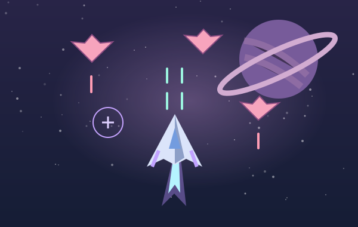</a><br><sub><a href="https://decoyindia.github.io/candy-drop/games/starfall/index.html"><b>[ Click to Launch Cabinet ]</b></a></sub> | 🏷️ **Wing:** Wing 1: Action<br>⏱️ **Session:** 2–3 min<br>🎯 **Objective:** Clear four enemy fleets, then defeat the sector-five mothership. Your ship fires automatically.<br><br>💡 **Gameplay Hook:** A small ship. A very big mission.<br>✨ **Dossier:** Four escalating alien fleets culminating in a massive sector-five mothership encounter with EMP pulse shields and laser warning grids.<br><br>🎮 **Controls:** **←** (`←` or `A`) &nbsp;•&nbsp; **→** (`→` or `D`) &nbsp;•&nbsp; **↑** (`↑` or `W`) &nbsp;•&nbsp; **↓** (`↓` or `S`) &nbsp;•&nbsp; **Pulse ◉** (`Space` or `X`)<br>🏆 **Medals:** 🥉 **1,600** &nbsp;•&nbsp; 🥈 **4,000** &nbsp;•&nbsp; 🥇 **7,000**<br><br><a href="https://decoyindia.github.io/candy-drop/games/starfall/index.html"><b>▶ PLAY STARFALL LIVE NOW →</b></a> |

### 🕹️ Neon Dojo &nbsp;•&nbsp; *Rooftop Martial Arts Duel*

| Visual Cabinet Art | Cabinet Dossier & Interactive Play |
| :---: | :--- |
| <a href="https://decoyindia.github.io/candy-drop/games/neon-dojo/index.html"></a><br><sub><a href="https://decoyindia.github.io/candy-drop/games/neon-dojo/index.html"><b>[ Click to Launch Cabinet ]</b></a></sub> | 🏷️ **Wing:** Wing 1: Action<br>⏱️ **Session:** 1–3 min<br>🎯 **Objective:** Defeat three rooftop challengers. Your health carries between bouts, with a 30-point recovery after a win.<br><br>💡 **Gameplay Hook:** Read the rival. Land the counter.<br>✨ **Dossier:** Authentic fighting game stamina management, high-risk parry windows, orange sweep jumps, and guard-breaking roundhouse kicks.<br><br>🎮 **Controls:** **←** (`←` or `A`) &nbsp;•&nbsp; **→** (`→` or `D`) &nbsp;•&nbsp; **Jump** (`Space` or `↑` or `W`) &nbsp;•&nbsp; **Jab** (`J` or `Z`) &nbsp;•&nbsp; **Kick** (`K` or `X`) &nbsp;•&nbsp; **Guard** (`L` or `C` or `ShiftLeft`)<br>🏆 **Medals:** 🥉 **1,000** &nbsp;•&nbsp; 🥈 **3,000** &nbsp;•&nbsp; 🥇 **5,000**<br><br><a href="https://decoyindia.github.io/candy-drop/games/neon-dojo/index.html"><b>▶ PLAY NEON DOJO LIVE NOW →</b></a> |

### 🕹️ Mini Golf Club &nbsp;•&nbsp; *Six-Hole Championship Links*

| Visual Cabinet Art | Cabinet Dossier & Interactive Play |
| :---: | :--- |
| <a href="https://decoyindia.github.io/candy-drop/games/mini-golf-club/index.html">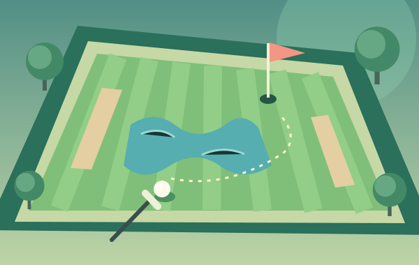</a><br><sub><a href="https://decoyindia.github.io/candy-drop/games/mini-golf-club/index.html"><b>[ Click to Launch Cabinet ]</b></a></sub> | 🏷️ **Wing:** Wing 3: Sports<br>⏱️ **Session:** 4–6 min<br>🎯 **Objective:** Finish all 6 holes in as few strokes as possible. The ball must slow near the cup to drop. Walls bounce; sand slows; water costs one penalty stroke.<br><br>💡 **Gameplay Hook:** Six holes. One perfect little round.<br>✨ **Dossier:** Realistic ball physics with kinetic wall rebounds, sand trap drag, water hazard penalties, and delicate green deceleration.<br><br>🎮 **Controls:** **Aim ↶** (`←` or `A`) &nbsp;•&nbsp; **Aim ↷** (`→` or `D`) &nbsp;•&nbsp; **Power +** (`↑` or `W`) &nbsp;•&nbsp; **Power −** (`↓` or `S`) &nbsp;•&nbsp; **Putt** (`Space`) &nbsp;•&nbsp; **Tee +1** (`R`)<br>🏆 **Medals:** 🥉 **1,400** &nbsp;•&nbsp; 🥈 **2,700** &nbsp;•&nbsp; 🥇 **3,600**<br><br><a href="https://decoyindia.github.io/candy-drop/games/mini-golf-club/index.html"><b>▶ PLAY MINI GOLF CLUB LIVE NOW →</b></a> |

### 🕹️ Merge Lab &nbsp;•&nbsp; *Atomic Element Synthesizer*

| Visual Cabinet Art | Cabinet Dossier & Interactive Play |
| :---: | :--- |
| <a href="https://decoyindia.github.io/candy-drop/games/merge-lab/index.html">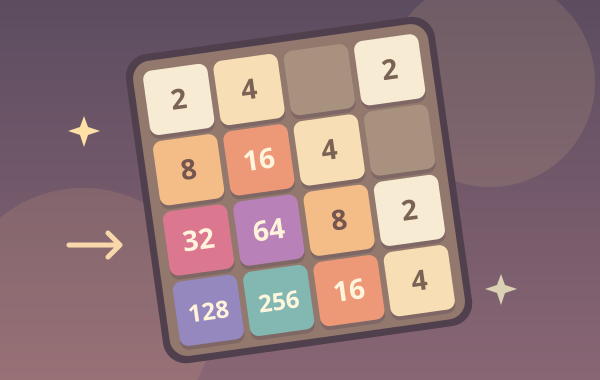</a><br><sub><a href="https://decoyindia.github.io/candy-drop/games/merge-lab/index.html"><b>[ Click to Launch Cabinet ]</b></a></sub> | 🏷️ **Wing:** Wing 5: Puzzle<br>⏱️ **Session:** At your pace<br>🎯 **Objective:** Slide the entire board to combine equal tiles. Each pair merges once per move. Build a 2048 tile to complete the experiment.<br><br>💡 **Gameplay Hook:** Make room for your next big idea.<br>✨ **Dossier:** Smooth directional tile synthesis with exact single-move undo, emergency score banking, and mathematically pure grid mechanics.<br><br>🎮 **Controls:** **←** (`←` or `A`) &nbsp;•&nbsp; **↑** (`↑` or `W`) &nbsp;•&nbsp; **↓** (`↓` or `S`) &nbsp;•&nbsp; **→** (`→` or `D`) &nbsp;•&nbsp; **Undo ↶** (`U` or `Z`) &nbsp;•&nbsp; **Bank score** (`F`)<br>🏆 **Medals:** 🥉 **1,200** &nbsp;•&nbsp; 🥈 **4,000** &nbsp;•&nbsp; 🥇 **12,000**<br><br><a href="https://decoyindia.github.io/candy-drop/games/merge-lab/index.html"><b>▶ PLAY MERGE LAB LIVE NOW →</b></a> |

### 🕹️ Orbit Guard &nbsp;•&nbsp; *Deep-Space Orbital Defense*

| Visual Cabinet Art | Cabinet Dossier & Interactive Play |
| :---: | :--- |
| <a href="https://decoyindia.github.io/candy-drop/games/orbit-guard/index.html">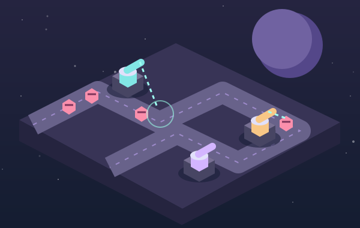</a><br><sub><a href="https://decoyindia.github.io/candy-drop/games/orbit-guard/index.html"><b>[ Click to Launch Cabinet ]</b></a></sub> | 🏷️ **Wing:** Wing 4: Strategy<br>⏱️ **Session:** 3–5 min<br>🎯 **Objective:** Protect the reactor through 8 waves. Select a build pad, choose a turret and press Build. Launch when your defense is ready.<br><br>💡 **Gameplay Hook:** Build smart. Hold the final wave.<br>✨ **Dossier:** Eight intense alien onslaughts featuring Pulse, Frost, and Nova turrets with budget credit economy, pad upgrades, and boss encounters.<br><br>🎮 **Controls:** **← Pad** (`←` or `A`) &nbsp;•&nbsp; **Pad →** (`→` or `D`) &nbsp;•&nbsp; **Type** (`T`) &nbsp;•&nbsp; **Build** (`B` or `Space`) &nbsp;•&nbsp; **Upgrade** (`U`) &nbsp;•&nbsp; **Sell** (`X`) &nbsp;•&nbsp; **Launch** (`N`)<br>🏆 **Medals:** 🥉 **2,500** &nbsp;•&nbsp; 🥈 **6,500** &nbsp;•&nbsp; 🥇 **10,000**<br><br><a href="https://decoyindia.github.io/candy-drop/games/orbit-guard/index.html"><b>▶ PLAY ORBIT GUARD LIVE NOW →</b></a> |

### 🕹️ Boomerang Bay &nbsp;•&nbsp; *Aerodynamic Catch & Throw*

| Visual Cabinet Art | Cabinet Dossier & Interactive Play |
| :---: | :--- |
| <a href="https://decoyindia.github.io/candy-drop/games/boomerang-bay/index.html">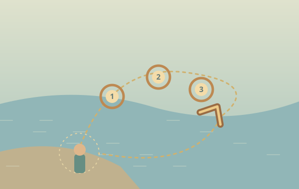</a><br><sub><a href="https://decoyindia.github.io/candy-drop/games/boomerang-bay/index.html"><b>[ Click to Launch Cabinet ]</b></a></sub> | 🏷️ **Wing:** Wing 7: Timing<br>⏱️ **Session:** 1 min<br>🎯 **Objective:** Clear three numbered targets in order in each of five arrangements before 90 seconds. Only the glowing next target can be collected.<br><br>💡 **Gameplay Hook:** Find the curve. Time the return.<br>✨ **Dossier:** Curved clockwise flight arcs requiring precise launch angles and split-second return catches to build lucrative multiplier streaks.<br><br>🎮 **Controls:** **Aim ↶** (`←` or `A`) &nbsp;•&nbsp; **Aim ↷** (`→` or `D`) &nbsp;•&nbsp; **Throw / Catch** (`Space`)<br>🏆 **Medals:** 🥉 **900** &nbsp;•&nbsp; 🥈 **2,400** &nbsp;•&nbsp; 🥇 **4,000**<br><br><a href="https://decoyindia.github.io/candy-drop/games/boomerang-bay/index.html"><b>▶ PLAY BOOMERANG BAY LIVE NOW →</b></a> |

### 🕹️ Mahjong Meadow &nbsp;•&nbsp; *Traditional Tile Solitaire*

| Visual Cabinet Art | Cabinet Dossier & Interactive Play |
| :---: | :--- |
| <a href="https://decoyindia.github.io/candy-drop/games/mahjong-meadow/index.html">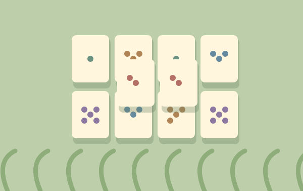</a><br><sub><a href="https://decoyindia.github.io/candy-drop/games/mahjong-meadow/index.html"><b>[ Click to Launch Cabinet ]</b></a></sub> | 🏷️ **Wing:** Wing 6: Tabletop<br>⏱️ **Session:** 3–6 min<br>🎯 **Objective:** Match two tiles with the same number and symbol. A free tile has nothing above it and an open left or right edge.<br><br>💡 **Gameplay Hook:** Make a little space. Match the edges.<br>✨ **Dossier:** Layered bamboo and flower tiles with edge-freedom rules, multi-level board clearing, and tranquil procedural vector graphics.<br><br>🎮 **Controls:** **←** (`←` or `A`) &nbsp;•&nbsp; **→** (`→` or `D`) &nbsp;•&nbsp; **↑** (`↑` or `W`) &nbsp;•&nbsp; **↓** (`↓` or `S`) &nbsp;•&nbsp; **Choose** (`Space` or `Enter`) &nbsp;•&nbsp; **Hint** (`H`) &nbsp;•&nbsp; **Undo** (`Z`) &nbsp;•&nbsp; **Mix** (`M`) &nbsp;•&nbsp; **Finish** (`B`)<br>🏆 **Medals:** 🥉 **900** &nbsp;•&nbsp; 🥈 **2,200** &nbsp;•&nbsp; 🥇 **3,200**<br><br><a href="https://decoyindia.github.io/candy-drop/games/mahjong-meadow/index.html"><b>▶ PLAY MAHJONG MEADOW LIVE NOW →</b></a> |

### 🕹️ Candy Drop &nbsp;•&nbsp; *The Founding Confectionery Run*

| Visual Cabinet Art | Cabinet Dossier & Interactive Play |
| :---: | :--- |
| <a href="https://decoyindia.github.io/candy-drop/index.html"></a><br><sub><a href="https://decoyindia.github.io/candy-drop/index.html"><b>[ Click to Launch Cabinet ]</b></a></sub> | 🏷️ **Wing:** Wing 8: Original<br>⏱️ **Session:** One more try<br>🎯 **Objective:** Catch falling candies to score points and build escalating combos.<br><br>💡 **Gameplay Hook:** Catch the candy. Chase the combo.<br>✨ **Dossier:** Catch luscious candies, dodge lethal ticking bombs, collect shimmering star power-ups, and keep the timeless arcade dream alive.<br><br>🎮 **Controls:** **Mouse / Touch / Arrows** (`←` or `→`)<br>🏆 **Medals:** 🥉 **50** &nbsp;•&nbsp; 🥈 **150** &nbsp;•&nbsp; 🥇 **300**<br><br><a href="https://decoyindia.github.io/candy-drop/index.html"><b>▶ PLAY CANDY DROP LIVE NOW →</b></a> |

---

## 📜 The Master Floor Directory: All 100 Cabinets

Browse the entire 100-cabinet collection organized across all eight arcade wings. Click any game to immediately launch its standalone, dedicated entry page:

### <a id="wing-1-action"></a>Wing 1: Action Sector &nbsp;(19 Cabinets)

<p align="center">
  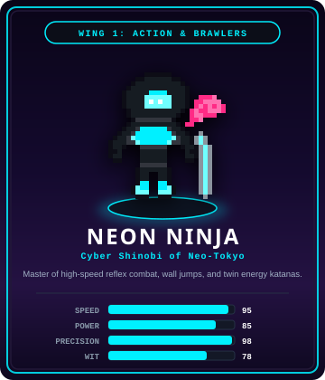
  <b>Lightning reflexes, orbital combat, martial duels & subterranean gauntlets</b><br>
  <i>Cyber Shinobi • 19 Cabinets</i><br>
  High-speed kinetic tests where split-second reaction times and spatial navigation dictate survival. Dodge bullet curtains, deflect sword strikes, leap crumbling rooftops, and delve into shadow-cast dungeons.
</p>
<br clear="all">

| Game | Category | Gameplay Hook | Session | Direct Cabinet Link |
| :--- | :--- | :--- | :---: | :--- |
| [**Neon Dojo**](https://decoyindia.github.io/candy-drop/games/neon-dojo/index.html) | `Fighting` | Read the rival. Land the counter. | 1–3 min | [**Play Now →**](https://decoyindia.github.io/candy-drop/games/neon-dojo/index.html) |
| [**Skybound**](https://decoyindia.github.io/candy-drop/games/skybound/index.html) | `Platformer` | Leap the rooftops. Keep your flow. | 1 min | [**Play Now →**](https://decoyindia.github.io/candy-drop/games/skybound/index.html) |
| [**Starfall**](https://decoyindia.github.io/candy-drop/games/starfall/index.html) | `Space shooter` | A small ship. A very big mission. | 2–3 min | [**Play Now →**](https://decoyindia.github.io/candy-drop/games/starfall/index.html) |
| [**Dungeon Lantern**](https://decoyindia.github.io/candy-drop/games/dungeon-lantern/index.html) | `Melee adventure` | Five keys. A guardian. A little courage. | 1–3 min | [**Play Now →**](https://decoyindia.github.io/candy-drop/games/dungeon-lantern/index.html) |
| [**Tether Twins**](https://decoyindia.github.io/candy-drop/games/tether-twins/index.html) | `Linked-body navigation` | Two little worlds. One way through. | 1 min | [**Play Now →**](https://decoyindia.github.io/candy-drop/games/tether-twins/index.html) |
| [**Echo Dodge**](https://decoyindia.github.io/candy-drop/games/echo-dodge/index.html) | `Memory-path survival` | Leave your past a little room. | 1 min | [**Play Now →**](https://decoyindia.github.io/candy-drop/games/echo-dodge/index.html) |
| [**Spark Sweep**](https://decoyindia.github.io/candy-drop/games/spark-sweep/index.html) | `Area claiming` | Bring empty space into the light. | 1–2 min | [**Play Now →**](https://decoyindia.github.io/candy-drop/games/spark-sweep/index.html) |
| [**Gravity Shift**](https://decoyindia.github.io/candy-drop/games/gravity-shift/index.html) | `Gravity runner` | The floor is a choice. Find your landing. | 1 min | [**Play Now →**](https://decoyindia.github.io/candy-drop/games/gravity-shift/index.html) |
| [**Treasure Diver**](https://decoyindia.github.io/candy-drop/games/treasure-diver/index.html) | `Exploration` | Find something worth bringing home. | 1–3 min | [**Play Now →**](https://decoyindia.github.io/candy-drop/games/treasure-diver/index.html) |
| [**Paper Flight**](https://decoyindia.github.io/candy-drop/games/paper-flight/index.html) | `Gliding` | Fold some courage. Ride the air. | 1 min | [**Play Now →**](https://decoyindia.github.io/candy-drop/games/paper-flight/index.html) |
| [**Rocket Landing**](https://decoyindia.github.io/candy-drop/games/rocket-landing/index.html) | `Lunar lander` | A quiet moon. Three soft arrivals. | 1–3 min | [**Play Now →**](https://decoyindia.github.io/candy-drop/games/rocket-landing/index.html) |
| [**Harbor Rescue**](https://decoyindia.github.io/candy-drop/games/harbor-rescue/index.html) | `Boat rescue` | Follow the current. Bring everyone home. | 1–3 min | [**Play Now →**](https://decoyindia.github.io/candy-drop/games/harbor-rescue/index.html) |
| [**Prism Breaker**](https://decoyindia.github.io/candy-drop/games/prism-breaker/index.html) | `Brick breaker` | Find your angle. Break a little brighter. | 1–3 min | [**Play Now →**](https://decoyindia.github.io/candy-drop/games/prism-breaker/index.html) |
| [**Serpent Garden**](https://decoyindia.github.io/candy-drop/games/serpent-garden/index.html) | `Snake` | A growing appetite. A thoughtful route. | 1–3 min | [**Play Now →**](https://decoyindia.github.io/candy-drop/games/serpent-garden/index.html) |
| [**Meteor Drift**](https://decoyindia.github.io/candy-drop/games/meteor-drift/index.html) | `Asteroid survival` | Trust your thrusters. Find clear skies. | 1–3 min | [**Play Now →**](https://decoyindia.github.io/candy-drop/games/meteor-drift/index.html) |
| [**Lava Lift**](https://decoyindia.github.io/candy-drop/games/lava-lift/index.html) | `Vertical platformer` | Keep a little sky above you. | 1–2 min | [**Play Now →**](https://decoyindia.github.io/candy-drop/games/lava-lift/index.html) |
| [**Ghost Lantern**](https://decoyindia.github.io/candy-drop/games/ghost-lantern/index.html) | `Maze chase` | Carry a little light. Bring it home. | 1–3 min | [**Play Now →**](https://decoyindia.github.io/candy-drop/games/ghost-lantern/index.html) |
| [**Shield Spin**](https://decoyindia.github.io/candy-drop/games/shield-spin/index.html) | `Radial defense` | Keep a little star alive. | 1–2 min | [**Play Now →**](https://decoyindia.github.io/candy-drop/games/shield-spin/index.html) |
| [**Blade Bloom**](https://decoyindia.github.io/candy-drop/games/blade-bloom/index.html) | `Fruit slicing` | A bright harvest. One sweeping gesture. | 1 min | [**Play Now →**](https://decoyindia.github.io/candy-drop/games/blade-bloom/index.html) |

### <a id="wing-2-racing"></a>Wing 2: Velocity Raceway &nbsp;(5 Cabinets)

<p align="center">
  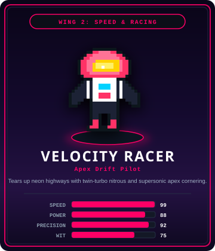
  <b>Horizon sprints, hairpin drifts, alpine descents & coastal regattas</b><br>
  <i>Apex Drift Pilot • 5 Cabinets</i><br>
  Pure mechanical motion and tire-smoke physics. Master braking points, thread through heavy rush-hour traffic, draft behind rival chassis for slipstream boosts, and hit every apex across asphalt, snow, and water.
</p>
<br clear="all">

| Game | Category | Gameplay Hook | Session | Direct Cabinet Link |
| :--- | :--- | :--- | :---: | :--- |
| [**Sunset Sprint**](https://decoyindia.github.io/candy-drop/games/sunset-sprint/index.html) | `Racing` | Chase the horizon. Beat the clock. | 1–2 min | [**Play Now →**](https://decoyindia.github.io/candy-drop/games/sunset-sprint/index.html) |
| [**Drift Circuit**](https://decoyindia.github.io/candy-drop/games/drift-circuit/index.html) | `Drift racing` | Find the line. Let the rear tires follow. | 1–2 min | [**Play Now →**](https://decoyindia.github.io/candy-drop/games/drift-circuit/index.html) |
| [**Rally Courier**](https://decoyindia.github.io/candy-drop/games/rally-courier/index.html) | `Bicycle delivery` | Five parcels and a city of useful shortcuts. | 1–2 min | [**Play Now →**](https://decoyindia.github.io/candy-drop/games/rally-courier/index.html) |
| [**Downhill Dash**](https://decoyindia.github.io/candy-drop/games/downhill-dash/index.html) | `Ski racing` | Carve forty gates through a mountain morning. | 1–2 min | [**Play Now →**](https://decoyindia.github.io/candy-drop/games/downhill-dash/index.html) |
| [**Sail Sprint**](https://decoyindia.github.io/candy-drop/games/sail-sprint/index.html) | `Sailing` | Six buoys and a breeze that rewards good lines. | 1–2 min | [**Play Now →**](https://decoyindia.github.io/candy-drop/games/sail-sprint/index.html) |

### <a id="wing-3-sports"></a>Wing 3: Champions Arena &nbsp;(13 Cabinets)

<p align="center">
  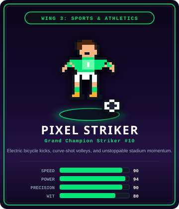
  <b>Billiards geometry, beach spikes, pitch strikes & six-hole links</b><br>
  <i>Grand Champion Striker • 13 Cabinets</i><br>
  Precision physics, trajectory angles, and tactical timing. Sink clutch putts on undulating greens, time your jump spike at the volleyball net, curl stones to the button, and chase 300 at the pocket bowling alley.
</p>
<br clear="all">

| Game | Category | Gameplay Hook | Session | Direct Cabinet Link |
| :--- | :--- | :--- | :---: | :--- |
| [**Pocket Striker**](https://decoyindia.github.io/candy-drop/games/pocket-striker/index.html) | `Football` | One pitch. Every touch matters. | 75-second match | [**Play Now →**](https://decoyindia.github.io/candy-drop/games/pocket-striker/index.html) |
| [**Mini Golf Club**](https://decoyindia.github.io/candy-drop/games/mini-golf-club/index.html) | `Physics` | Six holes. One perfect little round. | 4–6 min | [**Play Now →**](https://decoyindia.github.io/candy-drop/games/mini-golf-club/index.html) |
| [**Volley Vista**](https://decoyindia.github.io/candy-drop/games/volley-vista/index.html) | `Beach volleyball` | Meet the ball high. Make the beach yours. | 1–2 min | [**Play Now →**](https://decoyindia.github.io/candy-drop/games/volley-vista/index.html) |
| [**Sprint Start**](https://decoyindia.github.io/candy-drop/games/sprint-start/index.html) | `Athletics` | Wait for the gun. Run on rhythm. | 15–30 sec | [**Play Now →**](https://decoyindia.github.io/candy-drop/games/sprint-start/index.html) |
| [**Pool Parlor**](https://decoyindia.github.io/candy-drop/games/pool-parlor/index.html) | `Cue sports` | Six balls and twelve shots to clear the table. | 1–3 min | [**Play Now →**](https://decoyindia.github.io/candy-drop/games/pool-parlor/index.html) |
| [**Penalty Keeper**](https://decoyindia.github.io/candy-drop/games/penalty-keeper/index.html) | `Goalkeeping` | Read the shot. Commit to the dive. Own the goal. | 1 min | [**Play Now →**](https://decoyindia.github.io/candy-drop/games/penalty-keeper/index.html) |
| [**Rooftop Rally**](https://decoyindia.github.io/candy-drop/games/rooftop-rally/index.html) | `Table tennis` | Find the paddle edge. Make the rooftop yours. | 1–3 min | [**Play Now →**](https://decoyindia.github.io/candy-drop/games/rooftop-rally/index.html) |
| [**Hoops Minute**](https://decoyindia.github.io/candy-drop/games/hoops-minute/index.html) | `Basketball` | One minute. A drifting rim. Find your arc. | 1 min | [**Play Now →**](https://decoyindia.github.io/candy-drop/games/hoops-minute/index.html) |
| [**Pocket Bowler**](https://decoyindia.github.io/candy-drop/games/pocket-bowler/index.html) | `Bowling` | Read the oil. Pick up the spare. Chase 300. | 2–4 min | [**Play Now →**](https://decoyindia.github.io/candy-drop/games/pocket-bowler/index.html) |
| [**Home Run Hero**](https://decoyindia.github.io/candy-drop/games/home-run-hero/index.html) | `Baseball` | Twelve pitches, one perfect moment to swing. | 1 min | [**Play Now →**](https://decoyindia.github.io/candy-drop/games/home-run-hero/index.html) |
| [**Wicket Rush**](https://decoyindia.github.io/candy-drop/games/wicket-rush/index.html) | `Cricket` | Find the gap and chase 36 in two overs. | 1–2 min | [**Play Now →**](https://decoyindia.github.io/candy-drop/games/wicket-rush/index.html) |
| [**Archery Grove**](https://decoyindia.github.io/candy-drop/games/archery-grove/index.html) | `Archery` | Ten arrows. Read the breeze, trust your aim. | 1–3 min | [**Play Now →**](https://decoyindia.github.io/candy-drop/games/archery-grove/index.html) |
| [**Curling Cove**](https://decoyindia.github.io/candy-drop/games/curling-cove/index.html) | `Curling` | Three ends. Place, protect, and own the button. | 2–4 min | [**Play Now →**](https://decoyindia.github.io/candy-drop/games/curling-cove/index.html) |

### <a id="wing-4-strategy"></a>Wing 4: Tactical Command &nbsp;(12 Cabinets)

<p align="center">
  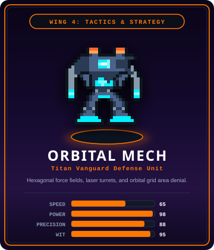
  <b>Orbital turret defense, sea-lane logistics, power grids & colony survival</b><br>
  <i>Titan Defense Vanguard • 12 Cabinets</i><br>
  Macro planning meets crisis management. Construct synchronized turret kill-zones, route sixteen cargo fleets without collisions, balance lunar colony oxygen budgets, and command the underground ant legion.
</p>
<br clear="all">

| Game | Category | Gameplay Hook | Session | Direct Cabinet Link |
| :--- | :--- | :--- | :---: | :--- |
| [**Orbit Guard**](https://decoyindia.github.io/candy-drop/games/orbit-guard/index.html) | `Strategy` | Build smart. Hold the final wave. | 3–5 min | [**Play Now →**](https://decoyindia.github.io/candy-drop/games/orbit-guard/index.html) |
| [**Harbor Master**](https://decoyindia.github.io/candy-drop/games/harbor-master/index.html) | `Traffic routing` | Draw safe sea lanes. Bring sixteen ships home. | 1–2 min | [**Play Now →**](https://decoyindia.github.io/candy-drop/games/harbor-master/index.html) |
| [**Snowball Siege**](https://decoyindia.github.io/candy-drop/games/snowball-siege/index.html) | `Ballistic artillery` | Read the breeze. Find your arc. | 1–3 min | [**Play Now →**](https://decoyindia.github.io/candy-drop/games/snowball-siege/index.html) |
| [**City Blocks**](https://decoyindia.github.io/candy-drop/games/city-blocks/index.html) | `City planning` | Build a neighborhood that works together. | 2–4 min | [**Play Now →**](https://decoyindia.github.io/candy-drop/games/city-blocks/index.html) |
| [**Power Grid**](https://decoyindia.github.io/candy-drop/games/power-grid/index.html) | `Utility management` | Six districts. One grid. Keep the city glowing. | 2–4 min | [**Play Now →**](https://decoyindia.github.io/candy-drop/games/power-grid/index.html) |
| [**Ant Colony**](https://decoyindia.github.io/candy-drop/games/ant-colony/index.html) | `Colony logistics` | Every ant has a job. Every raid needs a plan. | 2–4 min | [**Play Now →**](https://decoyindia.github.io/candy-drop/games/ant-colony/index.html) |
| [**Weather Station**](https://decoyindia.github.io/candy-drop/games/weather-station/index.html) | `Forecast strategy` | Read tomorrow’s sky. Protect the village. | 2–4 min | [**Play Now →**](https://decoyindia.github.io/candy-drop/games/weather-station/index.html) |
| [**Train Yard**](https://decoyindia.github.io/candy-drop/games/train-yard/index.html) | `Railway dispatch` | Three switches. Eighteen trains. Keep it moving. | 1–2 min | [**Play Now →**](https://decoyindia.github.io/candy-drop/games/train-yard/index.html) |
| [**Reef Keeper**](https://decoyindia.github.io/candy-drop/games/reef-keeper/index.html) | `Ecosystem strategy` | Sixteen days to give a reef its future. | 2–4 min | [**Play Now →**](https://decoyindia.github.io/candy-drop/games/reef-keeper/index.html) |
| [**Tidal Tactics**](https://decoyindia.github.io/candy-drop/games/tidal-tactics/index.html) | `Naval strategy` | Find the fleet beneath the silence. | 2–4 min | [**Play Now →**](https://decoyindia.github.io/candy-drop/games/tidal-tactics/index.html) |
| [**Orchard Keeper**](https://decoyindia.github.io/candy-drop/games/orchard-keeper/index.html) | `Farm management` | Nine plots and two minutes to grow a good season. | 2 min | [**Play Now →**](https://decoyindia.github.io/candy-drop/games/orchard-keeper/index.html) |
| [**Colony Balance**](https://decoyindia.github.io/candy-drop/games/colony-balance/index.html) | `Colony management` | Twenty decisions. A whole colony depends on you. | 3–5 min | [**Play Now →**](https://decoyindia.github.io/candy-drop/games/colony-balance/index.html) |

### <a id="wing-5-puzzle"></a>Wing 5: Logic Sanctum &nbsp;(30 Cabinets)

<p align="center">
  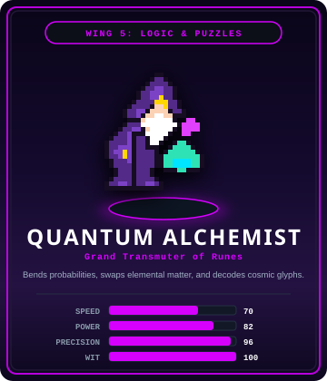
  <b>Arithmetic cross-sums, 8-queens chess, laser optics & synthesis labs</b><br>
  <i>Grand Transmuter of Runes • 30 Cabinets</i><br>
  The intellectual heart of the arcade floor. Thirty pristine analytical puzzles with provable solutions: untangle celestial constellations, synthesize high-value elements in Merge Lab, redirect laser beams, and decipher color codes.
</p>
<br clear="all">

| Game | Category | Gameplay Hook | Session | Direct Cabinet Link |
| :--- | :--- | :--- | :---: | :--- |
| [**Merge Lab**](https://decoyindia.github.io/candy-drop/games/merge-lab/index.html) | `Number puzzle` | Make room for your next big idea. | At your pace | [**Play Now →**](https://decoyindia.github.io/candy-drop/games/merge-lab/index.html) |
| [**Sum Cross**](https://decoyindia.github.io/candy-drop/games/sum-cross/index.html) | `Mini Kakuro` | A satisfying crossing of little sums. | 4–7 min | [**Play Now →**](https://decoyindia.github.io/candy-drop/games/sum-cross/index.html) |
| [**Queens Court**](https://decoyindia.github.io/candy-drop/games/queens-court/index.html) | `Eight queens` | Eight queens. Room for every diagonal. | 4–8 min | [**Play Now →**](https://decoyindia.github.io/candy-drop/games/queens-court/index.html) |
| [**Patchwork Park**](https://decoyindia.github.io/candy-drop/games/patchwork-park/index.html) | `Polyomino packing` | Give every little plot a place. | 4–8 min | [**Play Now →**](https://decoyindia.github.io/candy-drop/games/patchwork-park/index.html) |
| [**Logic Locks**](https://decoyindia.github.io/candy-drop/games/logic-locks/index.html) | `Futoshiki` | Four numbers. One neat way through. | 4–7 min | [**Play Now →**](https://decoyindia.github.io/candy-drop/games/logic-locks/index.html) |
| [**Word Ladder**](https://decoyindia.github.io/candy-drop/games/word-ladder/index.html) | `Word paths` | One letter takes you somewhere new. | 3–6 min | [**Play Now →**](https://decoyindia.github.io/candy-drop/games/word-ladder/index.html) |
| [**Island Bridges**](https://decoyindia.github.io/candy-drop/games/island-bridges/index.html) | `Hashi` | A few islands. One connected world. | 4–8 min | [**Play Now →**](https://decoyindia.github.io/candy-drop/games/island-bridges/index.html) |
| [**Mirror Memory**](https://decoyindia.github.io/candy-drop/games/mirror-memory/index.html) | `Sequence memory` | Remember a little melody. Turn it around. | 2–4 min | [**Play Now →**](https://decoyindia.github.io/candy-drop/games/mirror-memory/index.html) |
| [**Loop Garden**](https://decoyindia.github.io/candy-drop/games/loop-garden/index.html) | `Slitherlink` | A few quiet clues. One continuous walk. | 4–8 min | [**Play Now →**](https://decoyindia.github.io/candy-drop/games/loop-garden/index.html) |
| [**Marble Maze**](https://decoyindia.github.io/candy-drop/games/marble-maze/index.html) | `Tilt maze` | Three keys. One winding way home. | 2–3 min | [**Play Now →**](https://decoyindia.github.io/candy-drop/games/marble-maze/index.html) |
| [**Laser Lock**](https://decoyindia.github.io/candy-drop/games/laser-lock/index.html) | `Light routing` | A little reflection opens a whole new room. | 3–6 min | [**Play Now →**](https://decoyindia.github.io/candy-drop/games/laser-lock/index.html) |
| [**Word Forge**](https://decoyindia.github.io/candy-drop/games/word-forge/index.html) | `Anagrams` | Six letters. A workshop of possibilities. | 4–8 min | [**Play Now →**](https://decoyindia.github.io/candy-drop/games/word-forge/index.html) |
| [**Balance Box**](https://decoyindia.github.io/candy-drop/games/balance-box/index.html) | `Balance puzzle` | The right weight in the right place. | 3–6 min | [**Play Now →**](https://decoyindia.github.io/candy-drop/games/balance-box/index.html) |
| [**Trail Weaver**](https://decoyindia.github.io/candy-drop/games/trail-weaver/index.html) | `Numberlink` | A place for every path. | 4–8 min | [**Play Now →**](https://decoyindia.github.io/candy-drop/games/trail-weaver/index.html) |
| [**Mine Garden**](https://decoyindia.github.io/candy-drop/games/mine-garden/index.html) | `Minesweeper` | Read the numbers. Grow a safe garden. | 3–6 min | [**Play Now →**](https://decoyindia.github.io/candy-drop/games/mine-garden/index.html) |
| [**Memory Lane**](https://decoyindia.github.io/candy-drop/games/memory-lane/index.html) | `Matching pairs` | Sixteen cards. Eight familiar faces. | 2–4 min | [**Play Now →**](https://decoyindia.github.io/candy-drop/games/memory-lane/index.html) |
| [**Light Circuit**](https://decoyindia.github.io/candy-drop/games/light-circuit/index.html) | `Logic puzzle` | One switch changes the whole idea. | 3–6 min | [**Play Now →**](https://decoyindia.github.io/candy-drop/games/light-circuit/index.html) |
| [**Bubble Bay**](https://decoyindia.github.io/candy-drop/games/bubble-bay/index.html) | `Bubble shooter` | One bright shot. A whole cluster free. | 1–3 min | [**Play Now →**](https://decoyindia.github.io/candy-drop/games/bubble-bay/index.html) |
| [**Crate Escape**](https://decoyindia.github.io/candy-drop/games/crate-escape/index.html) | `Sokoban` | A place for every crate. | 3–6 min | [**Play Now →**](https://decoyindia.github.io/candy-drop/games/crate-escape/index.html) |
| [**Slide Studio**](https://decoyindia.github.io/candy-drop/games/slide-studio/index.html) | `Sliding puzzle` | Fifteen tiles. One little space. | At your pace | [**Play Now →**](https://decoyindia.github.io/candy-drop/games/slide-studio/index.html) |
| [**Number Nook**](https://decoyindia.github.io/candy-drop/games/number-nook/index.html) | `Mini Sudoku` | Four numbers. A moment of clarity. | 3–5 min | [**Play Now →**](https://decoyindia.github.io/candy-drop/games/number-nook/index.html) |
| [**Knight Quest**](https://decoyindia.github.io/candy-drop/games/knight-quest/index.html) | `Path puzzle` | Thirty-six squares. One winding path. | At your pace | [**Play Now →**](https://decoyindia.github.io/candy-drop/games/knight-quest/index.html) |
| [**Color Flood**](https://decoyindia.github.io/candy-drop/games/color-flood/index.html) | `Flood puzzle` | One corner becomes a whole canvas. | 2–4 min | [**Play Now →**](https://decoyindia.github.io/candy-drop/games/color-flood/index.html) |
| [**Constellation Link**](https://decoyindia.github.io/candy-drop/games/constellation-link/index.html) | `Spatial puzzle` | Untangle the night, star by star. | At your pace | [**Play Now →**](https://decoyindia.github.io/candy-drop/games/constellation-link/index.html) |
| [**Word Trail**](https://decoyindia.github.io/candy-drop/games/word-trail/index.html) | `Word search` | Follow a little trail of letters. | 2–5 min | [**Play Now →**](https://decoyindia.github.io/candy-drop/games/word-trail/index.html) |
| [**Ricochet Range**](https://decoyindia.github.io/candy-drop/games/ricochet-range/index.html) | `Bank-shot puzzle` | One clean shot. A new possibility. | 1–2 min | [**Play Now →**](https://decoyindia.github.io/candy-drop/games/ricochet-range/index.html) |
| [**Pipe Works**](https://decoyindia.github.io/candy-drop/games/pipe-works/index.html) | `Pipe routing` | Turn a few pipes into a flowing idea. | 3–6 min | [**Play Now →**](https://decoyindia.github.io/candy-drop/games/pipe-works/index.html) |
| [**Nonogram Nook**](https://decoyindia.github.io/candy-drop/games/nonogram-nook/index.html) | `Picture logic` | The picture is in the numbers. | 3–6 min | [**Play Now →**](https://decoyindia.github.io/candy-drop/games/nonogram-nook/index.html) |
| [**Code Breaker**](https://decoyindia.github.io/candy-drop/games/code-breaker/index.html) | `Deduction` | Four colors. One satisfying click. | 3–6 min | [**Play Now →**](https://decoyindia.github.io/candy-drop/games/code-breaker/index.html) |
| [**Peg Parlor**](https://decoyindia.github.io/candy-drop/games/peg-parlor/index.html) | `Peg solitaire` | A few thoughtful jumps. Just one peg. | 3–6 min | [**Play Now →**](https://decoyindia.github.io/candy-drop/games/peg-parlor/index.html) |

### <a id="wing-6-tabletop"></a>Wing 6: Parlor & Tabletop &nbsp;(8 Cabinets)

<p align="center">
  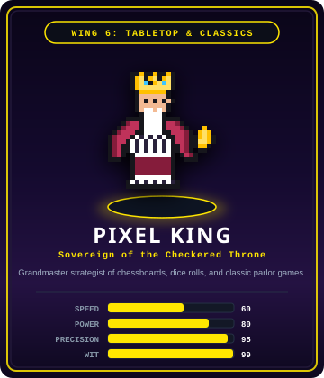
  <b>Mahjong matches, Reversi flips, dice poker & checkered tacticians</b><br>
  <i>Sovereign of the Checkered Throne • 8 Cabinets</i><br>
  Centuries of analog parlor elegance recreated with instant digital responsiveness. Outwit intelligent heuristic AI in four-in-a-row, claim critical corner tiles in Reversi, and clean the felt in Dice District.
</p>
<br clear="all">

| Game | Category | Gameplay Hook | Session | Direct Cabinet Link |
| :--- | :--- | :--- | :---: | :--- |
| [**Mahjong Meadow**](https://decoyindia.github.io/candy-drop/games/mahjong-meadow/index.html) | `Tile solitaire` | Make a little space. Match the edges. | 3–6 min | [**Play Now →**](https://decoyindia.github.io/candy-drop/games/mahjong-meadow/index.html) |
| [**Ultimate Grid**](https://decoyindia.github.io/candy-drop/games/ultimate-grid/index.html) | `Linked tic-tac-toe` | Small moves. Much bigger questions. | 3–6 min | [**Play Now →**](https://decoyindia.github.io/candy-drop/games/ultimate-grid/index.html) |
| [**Four in a Row**](https://decoyindia.github.io/candy-drop/games/four-in-row/index.html) | `Tabletop` | Build a fork. Connect your four. | 2–4 min | [**Play Now →**](https://decoyindia.github.io/candy-drop/games/four-in-row/index.html) |
| [**Reversi Room**](https://decoyindia.github.io/candy-drop/games/reversi-room/index.html) | `Tabletop` | A quiet corner can change everything. | 3–5 min | [**Play Now →**](https://decoyindia.github.io/candy-drop/games/reversi-room/index.html) |
| [**Royal Checkers**](https://decoyindia.github.io/candy-drop/games/royal-checkers/index.html) | `Tabletop` | Read the jump beyond the jump. | 3–6 min | [**Play Now →**](https://decoyindia.github.io/candy-drop/games/royal-checkers/index.html) |
| [**Dice District**](https://decoyindia.github.io/candy-drop/games/dice-district/index.html) | `Dice strategy` | Five dice. Thirteen good decisions. | 3–5 min | [**Play Now →**](https://decoyindia.github.io/candy-drop/games/dice-district/index.html) |
| [**Domino Trail**](https://decoyindia.github.io/candy-drop/games/domino-trail/index.html) | `Tabletop` | Follow the numbers. Clear your hand. | 2–5 min | [**Play Now →**](https://decoyindia.github.io/candy-drop/games/domino-trail/index.html) |
| [**Pinball Grove**](https://decoyindia.github.io/candy-drop/games/pinball-grove/index.html) | `Pinball` | Five flowers. One more ball. | 1–3 min | [**Play Now →**](https://decoyindia.github.io/candy-drop/games/pinball-grove/index.html) |

### <a id="wing-7-timing"></a>Wing 7: Rhythm & Reflex &nbsp;(12 Cabinets)

<p align="center">
  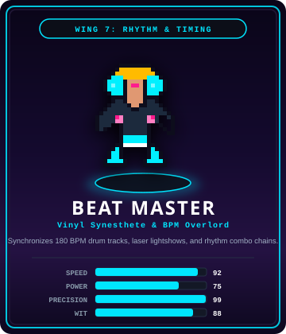
  <b>Curved boomerang catches, magnetic hauls, four-rail beats & cafe rushes</b><br>
  <i>Vinyl Synesthete & BPM Overlord • 12 Cabinets</i><br>
  Pure rhythmic synchronization and cadence. Calculate the aerodynamic return loop of boomerangs, time crane trolley releases with momentum preservation, brew espresso orders under pressure, and surf sonic rails.
</p>
<br clear="all">

| Game | Category | Gameplay Hook | Session | Direct Cabinet Link |
| :--- | :--- | :--- | :---: | :--- |
| [**Boomerang Bay**](https://decoyindia.github.io/candy-drop/games/boomerang-bay/index.html) | `Returning throws` | Find the curve. Time the return. | 1 min | [**Play Now →**](https://decoyindia.github.io/candy-drop/games/boomerang-bay/index.html) |
| [**Magnet Miner**](https://decoyindia.github.io/candy-drop/games/magnet-miner/index.html) | `Swing-hook mining` | Wait for something worthwhile. | 1–3 min | [**Play Now →**](https://decoyindia.github.io/candy-drop/games/magnet-miner/index.html) |
| [**Reaction Lab**](https://decoyindia.github.io/candy-drop/games/reaction-lab/index.html) | `Reaction timing` | A quiet moment. One clear signal. | 1 min | [**Play Now →**](https://decoyindia.github.io/candy-drop/games/reaction-lab/index.html) |
| [**Cargo Crane**](https://decoyindia.github.io/candy-drop/games/cargo-crane/index.html) | `Pendulum delivery` | A little momentum. A careful release. | 1–2 min | [**Play Now →**](https://decoyindia.github.io/candy-drop/games/cargo-crane/index.html) |
| [**Chroma Switch**](https://decoyindia.github.io/candy-drop/games/chroma-switch/index.html) | `Color timing` | Read the color. Find your opening. | 1–2 min | [**Play Now →**](https://decoyindia.github.io/candy-drop/games/chroma-switch/index.html) |
| [**Flappy Fin**](https://decoyindia.github.io/candy-drop/games/flappy-fin/index.html) | `One-button flight` | A tiny fin. A perfect little rhythm. | 1 min | [**Play Now →**](https://decoyindia.github.io/candy-drop/games/flappy-fin/index.html) |
| [**Tunnel Dash**](https://decoyindia.github.io/candy-drop/games/tunnel-dash/index.html) | `Reflex lanes` | Read the opening. Stay one gate ahead. | 1 min | [**Play Now →**](https://decoyindia.github.io/candy-drop/games/tunnel-dash/index.html) |
| [**Rhythm Rail**](https://decoyindia.github.io/candy-drop/games/rhythm-rail/index.html) | `Rhythm` | Four rails. Find your little groove. | 43 seconds | [**Play Now →**](https://decoyindia.github.io/candy-drop/games/rhythm-rail/index.html) |
| [**Stack Harbor**](https://decoyindia.github.io/candy-drop/games/stack-harbor/index.html) | `Precision` | Build a little higher. Land cleaner. | 1–2 min | [**Play Now →**](https://decoyindia.github.io/candy-drop/games/stack-harbor/index.html) |
| [**Perfect Pour**](https://decoyindia.github.io/candy-drop/games/perfect-pour/index.html) | `Timing` | A steady hand. Just enough. | 1 min | [**Play Now →**](https://decoyindia.github.io/candy-drop/games/perfect-pour/index.html) |
| [**Café Rush**](https://decoyindia.github.io/candy-drop/games/cafe-rush/index.html) | `Time management` | Brew, froth, finish. Keep the morning moving. | 90 sec | [**Play Now →**](https://decoyindia.github.io/candy-drop/games/cafe-rush/index.html) |
| [**Orbit Hop**](https://decoyindia.github.io/candy-drop/games/orbit-hop/index.html) | `Orbital timing` | Let go. Find a new world. | 1–2 min | [**Play Now →**](https://decoyindia.github.io/candy-drop/games/orbit-hop/index.html) |

### <a id="wing-8-original"></a>Wing 8: The Genesis Vault &nbsp;(1 Cabinets)

<p align="center">
  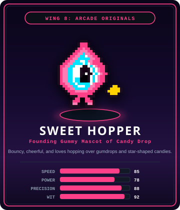
  <b>The founding confectionery spectacle that sparked the entire arcade universe</b><br>
  <i>Sweet Hopper • 1 Cabinet</i><br>
  The timeless classic that started it all in late 2024. Catch falling sweets, dodge explosive hazard bombs, maintain the combo multiplier, and experience the original zero-dependency browser game in its purest form.
</p>
<br clear="all">

| Game | Category | Gameplay Hook | Session | Direct Cabinet Link |
| :--- | :--- | :--- | :---: | :--- |
| [**Candy Drop**](https://decoyindia.github.io/candy-drop/index.html) | `Original arcade` | Catch the candy. Chase the combo. | One more try | [**Play Now →**](https://decoyindia.github.io/candy-drop/index.html) |

---

## 🪙 "Insert Coin to Run": Quickstart & Local Play

Candy Arcade is built from the ground up to require **zero compilation, zero transpilation, and zero build tools**. You can run the entire arcade directly off your local filesystem.

<p align="center">
  <a href="https://decoyindia.github.io/candy-drop/arcade.html">
    
  </a>
</p>

### 1. Direct Browser Launch (Zero Install)
Simply double-click `arcade.html` in your file explorer, or drag and drop `arcade.html` into any modern web browser (Chrome, Firefox, Safari, Edge). The entire arcade operates completely offline using relative asset paths!

### 2. Local HTTP Server
If you prefer running with a lightweight local web server for development or testing:

```bash
# Option A: Built-in Node 22+ server (Zero npm dependencies!)
npm start
# -> Serving Candy Arcade at http://localhost:8321/arcade.html

# Option B: Python 3 instant server
python3 -m http.server 8321
# -> Visit http://localhost:8321/arcade.html
```

### 3. Automated Verification & Quality Gate
The repository comes equipped with an industrial-grade verification harness that inspects rule determinism, puzzle solvability, storage isolation, and asset integrity:

```bash
# Run all 381 unit and contract tests in Node.js
npm test

# Run repository link, asset, HTML, and catalog verification
node scripts/verify-all.cjs

# (Optional) Run Playwright browser smoke test suite on desktop & mobile viewports
npm run test:browser
```

---

## ⚙️ Architecture: Inside the Cabinet's Guts

Candy Arcade is engineered as a masterclass in modern, dependency-free web systems. Here is how the runtime operates under the hood:

```
   ┌────────────────────────────────────────────────────────────────────────┐
   │                       BROWSER VIEWPORT / CANVAS                        │
   │               (Dynamic 16:10 Integer DPR Scaled Surface)               │
   └───────────────────────────────────┬────────────────────────────────────┘
                                       │
        ┌──────────────────────────────┴──────────────────────────────┐
        ▼                                                             ▼
┌────────────────────────────────┐           ┌────────────────────────────────┐
│        assets/arcade.js        │           │         assets/core.js         │
│  (Universal Cabinet Firmware)  │           │   (Nervous System & Catalog)   │
├────────────────────────────────┤           ├────────────────────────────────┤
│ • 60 FPS requestAnimationFrame │           │ • 100-Game Master Catalog      │
│ • Input Duality (Keys & Touch) │           │ • Mulberry32 Seeded PRNG       │
│ • Procedural Web Audio Synth   │           │ • UTC Midnight Daily Cycle     │
│ • cancelInput Gesture Safety   │           │ • Resilient Dual-Tier Storage  │
│ • Responsive Board Zoom (+/-)  │           │ • Schema Sanitization & Memory │
└────────────────────────────────┘           └────────────────────────────────┘
                                       │
                                       ▼
        ┌─────────────────────────────────────────────────────────────┐
        │                 games/<slug>/game.js (x100)                 │
        │               Independent Game Micro-Engines                │
        │       • Pure Canvas 2D Drawing   • Deterministic Rules      │
        │       • Isolated Local State     • Three-Tier Medals        │
        └─────────────────────────────────────────────────────────────┘
```

### 1. The 960 × 600 Virtual Canvas Engine
Every game renders into a canonical **960 × 600 logical coordinate space** (a comfortable 16:10 widescreen proportion).
* **Deterministic DPR Bounding:** The engine queries `window.devicePixelRatio` and caps the backing store resolution at `2.0` to prevent GPU overheating and memory exhaustion on high-density Retina or 4K mobile displays.
* **Aspect Preservation:** The canvas automatically scales via CSS transform matrices, maintaining letterboxed or pillarboxed centering with zero distortion.
* **Focus View Cropping:** Board-focused titles define a `focus: [x, y, w, h]` viewport crop. Players can tap the `+` / `−` zoom button on dense boards to enlarge the interactive puzzle area on smaller phone screens without sacrificing control access.

### 2. The Deterministic PRNG & UTC Daily Synchronization
Procedural levels and shuffle algorithms avoid `Math.random()` entirely:
* **Mulberry32 Algorithm:** Implements a 32-bit stateful linear generator initialized via 32-bit FNV-1a hash strings.
* **Global Daily Seed:** The daily challenge seed is computed from `dailySeedForDate(new Date())` using ISO UTC format (`YYYY-MM-DD`). At exactly `00:00:00 UTC`, players across the entire planet automatically receive identical puzzle layouts, hazard patterns, and card decks.
* **Purity Guarantee:** Automated tests verify that rendering passes never advance the PRNG seed, guaranteeing reproducible simulations.

### 3. Universal Input Duality & The `cancelInput` Safety Valve
* **Simultaneous Pointer & Key Translation:** Arrow keys, WASD, touch taps, mouse clicks, and drag gestures map to identical action identifiers.
* **Interrupted Gesture Protection:** If a player drags to charge a golf putt or slingshot throw and drags off-screen or pauses mid-gesture, `cancelInput` cleanly discards the accumulated force, preventing accidental misfires.
* **Tab Visibility Protection:** Leaving the browser tab immediately pauses the game loop, mutes procedural audio, and flushes all held input states.

### 4. Zero-Byte Procedural Web Audio Chip
Rather than burdening users with dozens of audio asset HTTP requests, the cabinet includes an onboard polyphonic synthesizer powered by the native Web Audio API:
* **Waveform Synthesis:** Real-time generation of `sine`, `triangle`, `square`, `sawtooth`, and periodic white noise buffers.
* **Six Universal Sonic Profiles:** `tap`, `coin`, `hit`, `powerup`, `win`, and `gameover`.
* **Dynamic Pitch Modulation:** Frequencies dynamically scale with combo streaks and score multipliers for rich auditory tactile feedback.

### 5. Resilient Local Data Storage
Scores and achievements are safeguarded by a fault-tolerant storage adapter:
* **Dual-Tier Fallback:** If `localStorage` is blocked by private browsing mode or quota limits, the engine gracefully transitions to an in-memory session cache.
* **Sanitization Boundary:** Stored data is validated against catalog IDs to discard foreign or corrupted keys without crashing.

---

## 🏆 Retro Arcade Achievements

Test your mastery across the entire 100-cabinet floor to unlock all six legendary arcade achievement badges:

<p align="center">
  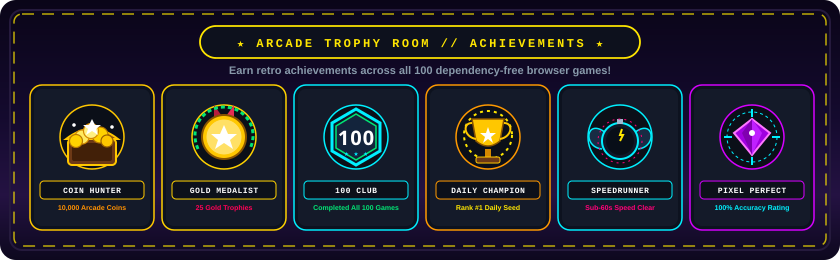
</p>

| Badge | Achievement Title | Qualification Criteria |
| :---: | :--- | :--- |
| 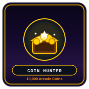 | **Coin Hunter** | Play and complete a session on at least 10 different arcade cabinets in a single day. |
| 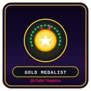 | **Gold Medalist** | Surpass the Gold medal score threshold on any arcade cabinet. |
| 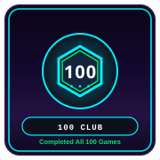 | **The 100 Club** | Explore and log a recorded run across all 100 cabinets in the collection. |
| 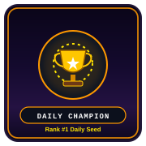 | **Daily Champion** | Achieve a personal best score on the rotating UTC Midnight Daily Challenge. |
| 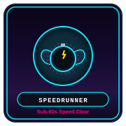 | **Speedrunner** | Finish any timed course or puzzle cabinet in under 50% of par duration. |
| 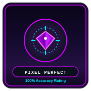 | **Pixel Perfect** | Complete a full game session with zero damage, zero penalties, or a 100% combo rate. |

---

## 🕹️ Easter Eggs & Cabinet Secrets

True retro arcades always conceal hidden dip switches, secret button sequences, and legendary leaderboards. Candy Arcade is no exception:

### 🏆 Retro High Scores Hall of Fame

<p align="center">
  
</p>

### 🤫 The Secret Konami Code Protocol

<p align="center">
  <a href="https://decoyindia.github.io/candy-drop/arcade.html">
    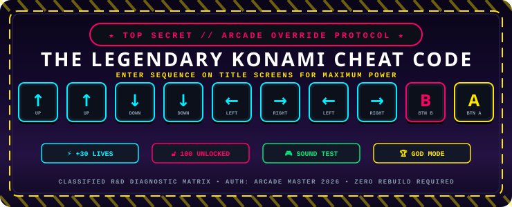
  </a>
</p>

On any keyboard, while browsing the collection hub or playing in a cabinet, enter the legendary sequence:

```
   [ ↑ ]  [ ↑ ]  [ ↓ ]  [ ↓ ]  [ ← ]  [ → ]  [ ← ]  [ → ]  [ B ]  [ A ]
```

**Cabinet Perks Unlocked:**
* 🌟 **Golden CRT Phosphor Glow:** Overrides the hub styling with high-voltage amber retro CRT scanlines.
* 🎆 **Cosmic Confetti Explosion:** Rains retro canvas pixel fireworks across the screen.
* 🍬 **Secret Hopper Soundboard:** Triggers retro sound chip arpeggios and unlocks developer easter egg remarks.

### 🛠️ Developer Inspection Mode
Append `?test=1` to any game URL (e.g. `https://decoyindia.github.io/candy-drop/games/sunset-sprint/index.html?test=1`) to expose the hidden simulation test harness. This unlocks step-by-step frame ticking, collision boundary outlines, and automated rule inspection hooks used by the verification test suite.

---

## 👾 CONTINUE? 9... 8... 7...

```
    ╔════════════════════════════════════════════════════════════════════════════════╗
    ║                                                                                ║
    ║   ██████╗  █████╗ ███╗   ███╗███████╗     ██████╗ ██╗   ██╗███████╗██████╗     ║
    ║  ██╔════╝ ██╔══██╗████╗ ████║██╔════╝    ██╔═══██╗██║   ██║██╔════╝██╔══██╗    ║
    ║  ██║  ███╗███████║██╔████╔██║█████╗      ██║   ██║██║   ██║█████╗  ██████╔╝    ║
    ║  ██║   ██║██╔══██║██║╚██╔╝██║██╔══╝      ██║   ██║╚██╗ ██╔╝██╔══╝  ██╔══██╗    ║
    ║  ╚██████╔╝██║  ██║██║ ╚═╝ ██║███████╗    ╚██████╔╝ ╚████╔╝ ███████╗██║  ██║    ║
    ║   ╚═════╝ ╚═╝  ╚═╝╚═╝     ╚═╝╚══════╝     ╚═════╝   ╚═══╝  ╚══════╝╚═╝  ╚═╝    ║
    ║                                                                                ║
    ║                         C O N T I N U E  ?   9 ... 8 ... 7 ...                 ║
    ║                                                                                ║
    ║                 [ INSERT COIN TO KEEP THE ARCADE RUNNING FOREVER ]             ║
    ║                                                                                ║
    ╚════════════════════════════════════════════════════════════════════════════════╝
```

<p align="center">
  <a href="https://decoyindia.github.io/candy-drop/arcade.html"><b>🕹️ JUMP BACK TO THE ARCADE FLOOR →</b></a>
  &nbsp;&nbsp;•&nbsp;&nbsp;
  <a href="docs/ABOUT.md"><b>📖 READ THE FULL DESIGN MANIFESTO →</b></a>
  &nbsp;&nbsp;•&nbsp;&nbsp;
  <a href="docs/REPO_METADATA.md"><b>🏷️ VIEW REPO METADATA & TOPICS →</b></a>
  &nbsp;&nbsp;•&nbsp;&nbsp;
  <a href="docs/game-api.md"><b>🛠️ CONTRIBUTE A 101ST CABINET →</b></a>
</p>

### 📚 Further Reading & Deep Dives
* [docs/ABOUT.md](docs/ABOUT.md) — The deep editorial history, zero-dependency manifesto, sound chip specs, and 30-year web artifact promise.
* [docs/REPO_METADATA.md](docs/REPO_METADATA.md) — Repository description, 22 curated GitHub topic tags, and brand manifesto.
* [docs/game-api.md](docs/game-api.md) — The complete developer contract for authoring and mounting new arcade cabinets.
* [portal.html](portal.html) — The interactive web audio soundboard, PRNG hasher, and lucky cabinet draw.

### 📜 Open Source License
This repository and its entire 100-cabinet game collection are open source and free for the world to explore, study, play, and enjoy. Built with ❤️ for the pure web platform.

<p align="center">
  <b>Candy Arcade © 2024–2026. Made with pure web standards. No cookies. No trackers. Just play.</b>
</p>
